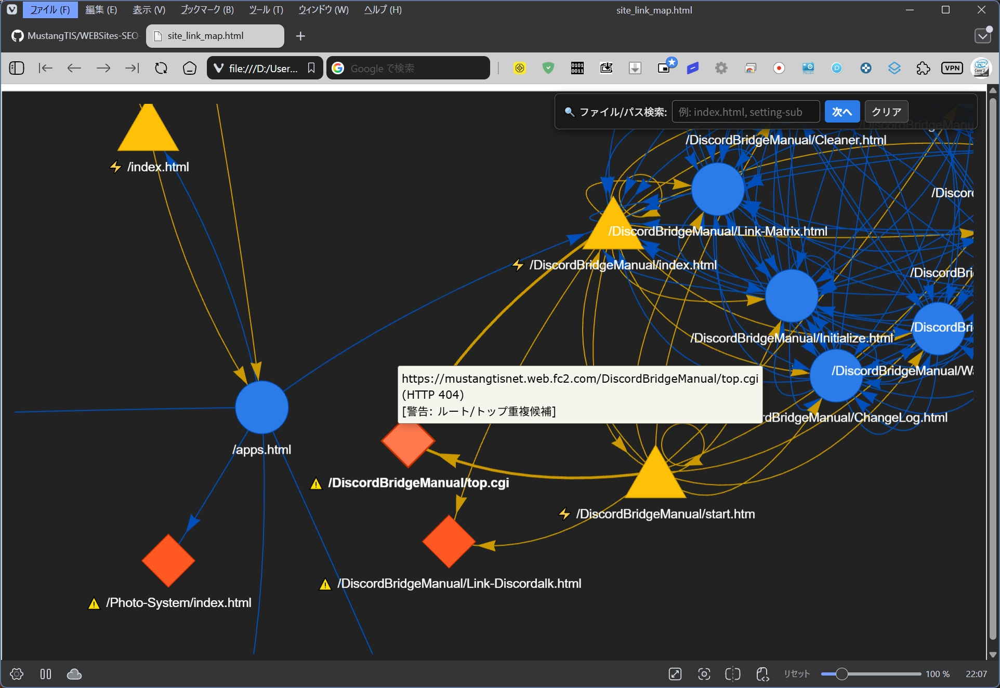

* `Asset/map1.jpg`（警告レポート画面）


* `Asset/map2.jpg`（リンクマップの可視化画面）
* `Asset/Canonical.jpg`（Canonicalタグ自動挿入ツールのGUI画面）


* `Asset/sitemaps.jpg`（Automation Sitemap Builderの画面）

---

```markdown
# WEBSites-SEO-Helper

WEBサイトのSEO対策補助ツールセットです。  
リンク構造の可視化・警告確認による構成整理、`<link rel="canonical">` の一括挿入・更新、および `sitemap.xml` の生成までをまとめて扱えるように構成しています[cite: 6, 7]。

---

## 収録ツールと役割

本リポジトリは `SEO-Helper/` 配下に以下の3ツールを収録しています。

1. **Link_MAP_Visualizer**（`SEO-Helper/Link_MAP_Visualizer/`）
   - サイト内のリンク構造の可視化や、ルート（`/`）と `index.html`（や `top.cgi`・`start.htm` などのトップ相当ファイル）の混在・重複、リンク切れ（404）などの警告レポートを確認するためのツールです[cite: 7]。
   - 構成ファイル：`link_map.py`、`ReadMe.txt`、`Run.bat`
   - [cite: 7]
   - 

2. **Canonical-Injector**（`SEO-Helper/Canonical-Injector/`）
   - 対象フォルダ内のHTMLファイルに対して `<link rel="canonical">` を挿入・更新するツールです[cite: 6]。
   - `index.html` を省略してディレクトリURL（`/`）に寄せるオプションに対応しています[cite: 6]。
   - 構成ファイル：`canonicaltag.py`、`ReadMe.txt`、`Run.bat`
   - [cite: 6]

3. **Automation_Sitemaps**（`SEO-Helper/Automation_Sitemaps/`）
   - 対象URLをスキャンし、URLごとの登録対象・`Priority`・`robots除外` などを確認しながら `sitemap.xml`（必要に応じて `robots.txt` も）を生成するツールです。
   - 構成ファイル：`automation_sitemaps.py`、`ReadMe.txt`、`Run.bat`
   - 

---

## 基本的な実行順序

1. **リンク構造の確認・修正（`Link_MAP_Visualizer`）**
   - リンクマップや警告レポートで、重複URL・混在・リンク切れなどの不整合を確認し、HTML側のリンクや構成を修正します[cite: 7]。
2. **Canonicalタグの挿入・更新（`Canonical-Injector`）**
   - ターゲットフォルダとベースURLを指定し、正規URL（`/` 統一など）をHTMLへ反映します[cite: 6]。
3. **サイトマップの生成（`Automation_Sitemaps`）**
   - サイトをスキャンして対象URLや優先度を確認し、`sitemap.xml` を出力します。

---

## ディレクトリ構成

```text
WEBSites-SEO-Helper/
├─ Asset/                    # デモ用素材・検証用ファイル・スクリーンショットなど
├─ SEO-Helper/
│  ├─ Automation_Sitemaps/
│  │  ├─ automation_sitemaps.py
│  │  ├─ ReadMe.txt
│  │  └─ Run.bat
│  ├─ Canonical-Injector/
│  │  ├─ canonicaltag.py
│  │  ├─ ReadMe.txt
│  │  └─ Run.bat
│  └─ Link_MAP_Visualizer/
│     ├─ link_map.py
│     ├─ ReadMe.txt
│     └─ Run.bat
├─ LICENSE
└─ README.md

```

---

## 使い方・詳細

各ツールの具体的な操作方法やオプション、注意点については、それぞれのフォルダにある `ReadMe.txt` および `Run.bat` を参照してください。

---

## ライセンス

`LICENSE` ファイルの条件に従います。