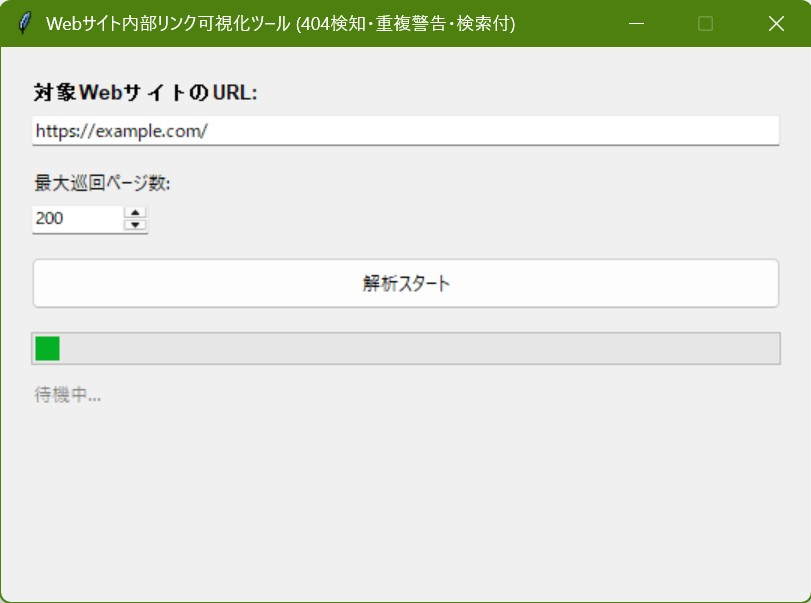
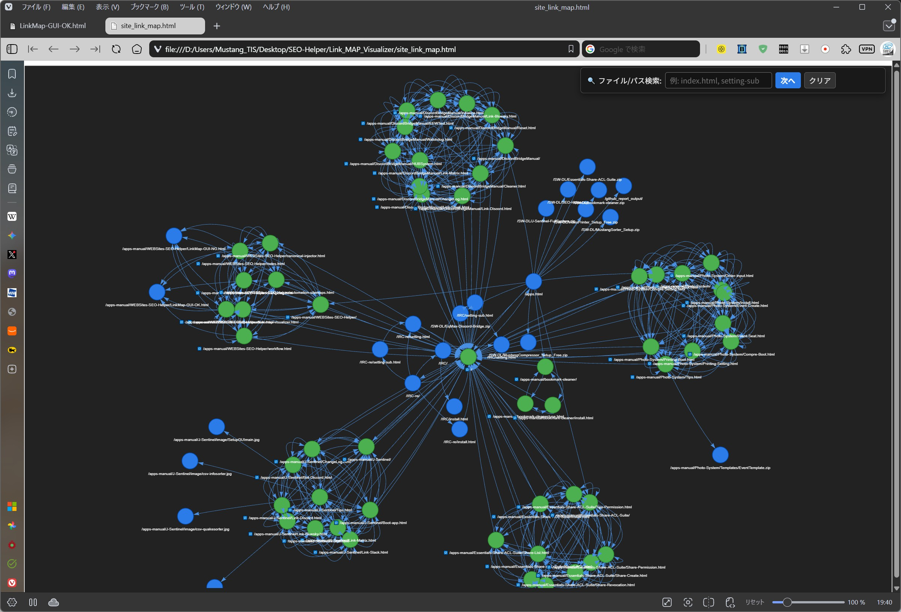
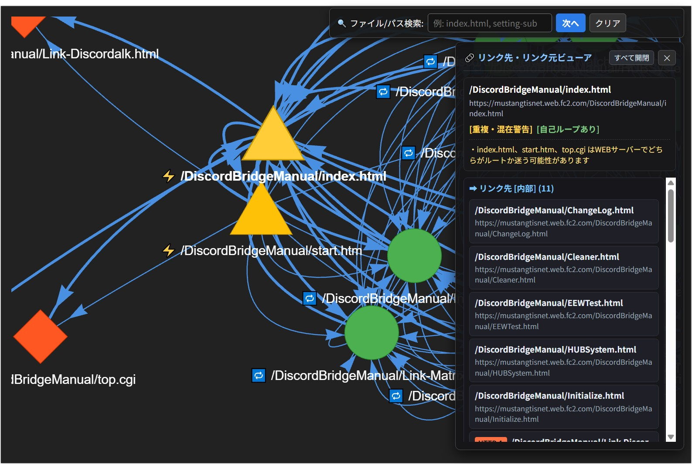
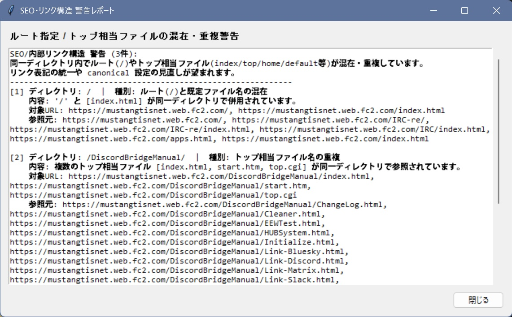
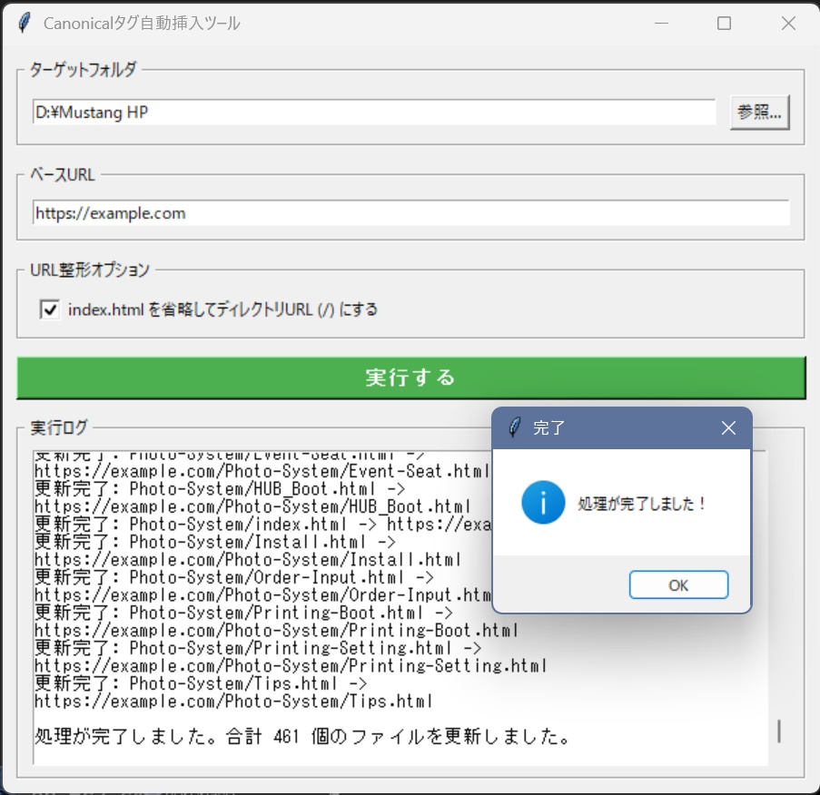
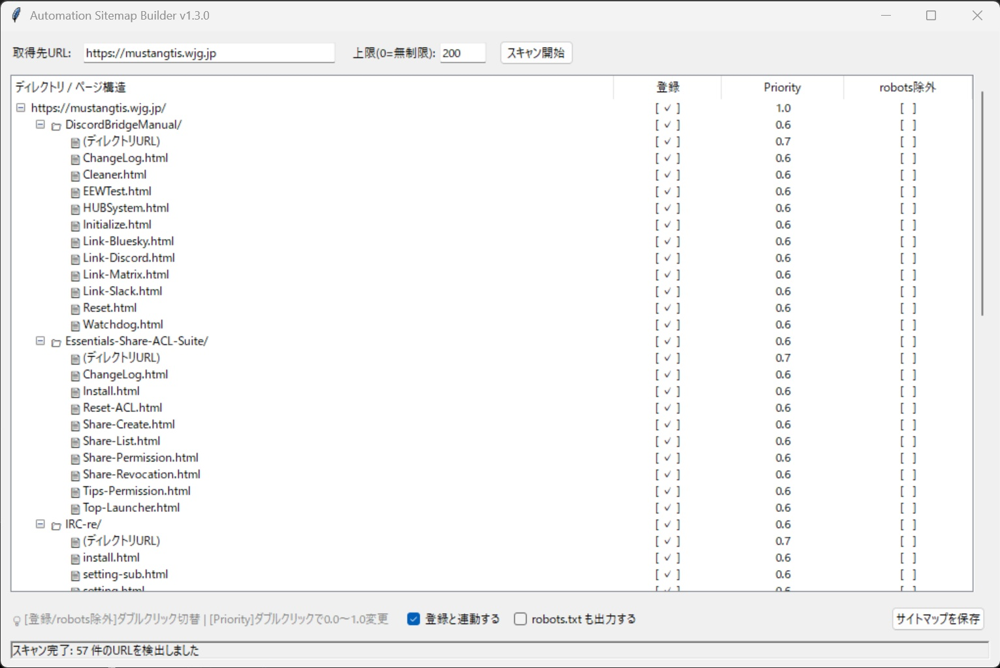

# WEBSites-SEO-Helper


WEBサイトのSEO対策補助ツールセットです。  
リンク構造の可視化・警告確認による構成整理、`<link rel="canonical">` の一括挿入・更新、および `sitemap.xml` の生成までをまとめて扱えるように構成しています。

---

## ダウンロード・マニュアル

最新版アーカイブは GitHub Releases から取得できます。各ツールの詳しい操作解説はマニュアルページを参照してください。

- **最新リリース（Releases / Latest）:** https://github.com/MustangTIS/WEBSites-SEO-Helper/releases/latest
- **オンラインマニュアル:** https://mustangtis.wjg.jp/apps-manual/WEBSites-SEO-Helper/

---

## 動作環境

- **OS:** Windows 10 / Windows 11（`Run.bat` による起動を想定）
- **実行環境:** Python 3.x（各スクリプトに必要な標準ライブラリ・追加パッケージは各ツールの `ReadMe.txt` を参照）
- **ブラウザ:** リンクマップHTML（`site_link_map.html` 等）の閲覧用

---

## 基本的な実行順序

1. **リンク構造の確認・修正（`Link_MAP_Visualizer`）**
   - リンクマップや警告レポート、サイドパネルの「リンク先・リンク元ビューア」で、重複URL・ルート混在・自己ループ・リンク切れ（404）などの不整合を確認し、HTML側のリンクや構成を修正します。

| 画面・機能 | プレビュー | 概要 |
| :--- | :---: | :--- |
| 起動画面 |  | 対象URLと最大巡回ページ数を指定してクロールを実行します。 |
| 全体マップ |  | 自己ループを緑色ノード（矢印非表示）、通常エッジを青系で描画します。 |
| 重複・混在警告とビューア |  | サイドパネルに警告理由や「リンク先 [内部] / リンク元 [内部] / 外部リンク」を表示します。 |
| 警告レポート |  | 同一ディレクトリ内のルート（`/`）混在やトップ相当ファイル重複を一覧表示します。 |

2. **Canonicalタグの挿入・更新（`Canonical-Injector`）**
   - ターゲットフォルダとベースURLを指定し、`index.html` を省略してディレクトリURL（`/`）に寄せるオプションなどを活用して正規URLをHTMLへ反映します。

| 画面・機能 | プレビュー | 概要 |
| :--- | :---: | :--- |
| Canonicalタグ自動挿入ツール |  | フォルダ単位で `<link rel="canonical">` を一括挿入・更新します。 |

3. **サイトマップの生成（`Automation_Sitemaps`）**
   - サイトをスキャンして対象URLや `Priority`・`robots除外` などを確認しながら `sitemap.xml` を出力します。

| 画面・機能 | プレビュー | 概要 |
| :--- | :---: | :--- |
| Automation Sitemap Builder |  | スキャン結果を確認しながら `sitemap.xml`（必要に応じて `robots.txt` も）を生成します。 |

---

## 収録ツールと役割

本リポジトリは `SEO-Helper/` 配下に以下の3ツールを収録しています。

1. **Link_MAP_Visualizer**（`SEO-Helper/Link_MAP_Visualizer/`）
   - サイト内のリンク構造の可視化（自己ループの緑色ノード表示・矢印非表示、通常エッジの青系統一）、ルート（`/`）と `index.html`（や `top.cgi`・`start.htm` などのトップ相当ファイル）の混在・重複検知、リンク切れ（404）警告、およびノード選択時の「リンク先・リンク元ビューア」（内部リンク先/元・外部リンクの折りたたみ表示、警告理由表示）を確認するためのツールです。
   - 構成ファイル：`link_map.py`、`ReadMe.txt`、`Run.bat`

2. **Canonical-Injector**（`SEO-Helper/Canonical-Injector/`）
   - 対象フォルダ内のHTMLファイルに対して `<link rel="canonical">` を挿入・更新するツールです。
   - `index.html` を省略してディレクトリURL（`/`）に寄せるオプションに対応しています。
   - 構成ファイル：`canonicaltag.py`、`ReadMe.txt`、`Run.bat`

3. **Automation_Sitemaps**（`SEO-Helper/Automation_Sitemaps/`）
   - 対象URLをスキャンし、URLごとの登録対象・`Priority`・`robots除外` などを確認しながら `sitemap.xml`（必要に応じて `robots.txt` も）を生成するツールです。
   - 構成ファイル：`automation_sitemaps.py`、`ReadMe.txt`、`Run.bat`

---

## ディレクトリ構成

```text
WEBSites-SEO-Helper/
├─ Asset/                    # スクリーンショット・デモ用画像
│  ├─ Canonical.jpg
│  ├─ LinkMAP-Output.jpg
│  ├─ LinkMAP-TOP.jpg
│  ├─ Normalization.jpg
│  ├─ map1.jpg
│  └─ sitemaps.jpg
├─ SEO-Helper/
│  ├─ Automation_Sitemaps/
│  │  ├─ automation_sitemaps.py
│  │  ├─ ReadMe.txt
│  │  └─ Run.bat
│  ├─ Canonical-Injector/
│  │  ├─ canonicaltag.py
│  │  ├─ ReadMe.txt
│  │  └─ Run.bat
│  └─ Link_MAP_Visualizer/
│     ├─ link_map.py
│     ├─ ReadMe.txt
│     └─ Run.bat
├─ LICENSE
└─ README.md

```

---

## 使い方・詳細

各ツールの具体的な操作方法やオプション、注意点については、それぞれのフォルダにある `ReadMe.txt` および [オンラインマニュアル](https://mustangtis.wjg.jp/apps-manual/WEBSites-SEO-Helper/) を参照してください。

---

## ライセンス

MIT License（詳細は `LICENSE` ファイルを参照してください）。
